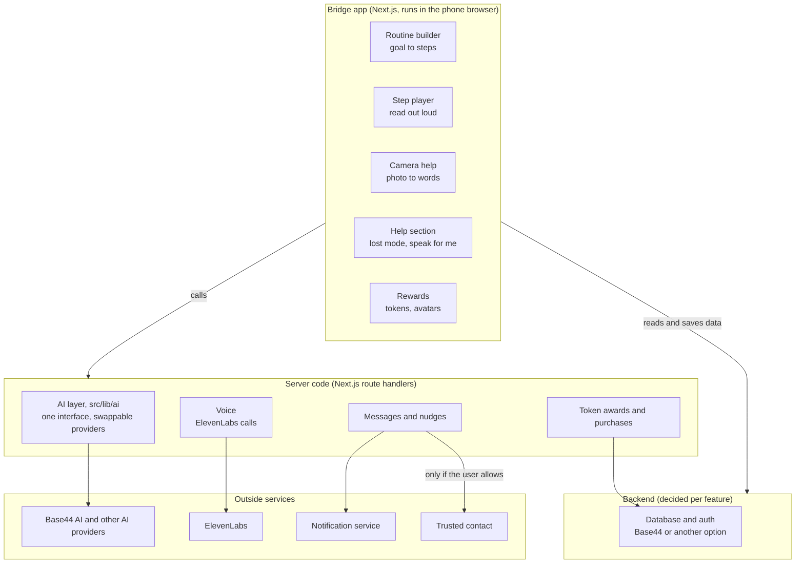

# Bridge

**AI support for people with disabilities who don't have someone to help them.**

Bridge helps people follow daily routines, understand confusing paperwork, and get help when they're lost or stuck. Support is dynamic: it fades as the person becomes more independent.

Built for the "Best use of Base44 AI" hackathon track. The app is written in VS Code (Next.js) and connected to [Base44](https://base44.com) later. Some features may use Base44 AI.

## Who it's for

- People with autism, ADHD, a stutter, or intellectual disabilities
- People who aged out of school paraprofessional support
- People who lost a family caregiver

## Core principle

The user decides who sees what they do. Trusted contacts are optional and only see what the user allows. Bridge is support, not monitoring.

## Features

| Feature | What it does | Owner |
| --- | --- | --- |
| AI routine builder | User says a goal, AI plans the steps with pictures | Brandon |
| Step-by-step player | One step per screen, big text, read aloud | Adrian |
| Help with this (camera) | Take a picture of a bill or letter; AI explains what it is and what to do, by voice and text | Adrian (confirm) |
| Check-ins and notifications | Reminders when a step is due; makes sure tasks get done | Nati |
| Help section | Lost mode sends location to a trusted contact, "speak for me" talks for the user when they can't, trusted contacts, 911 and 988 options | George |
| Rewards | Finishing tasks and routines earns tokens to buy avatars; streaks unlock exclusive avatars | TBD (suggest Nati) |

## Rewards

Doing your tasks and routines earns tokens. Spend tokens in the avatar shop, or keep a streak going to unlock avatars you can't buy. Your equipped avatar becomes your guide in the step player.

- Tokens are never lost, and asking for help earns the same tokens as doing it alone, so nobody avoids the help button to protect rewards.
- Streaks are forgiving: streak freezes cover a missed day.
- Tokens can't be bought with real money.

Details: [docs/rewards.md](docs/rewards.md)

## Architecture



More detail: [docs/architecture.md](docs/architecture.md)

## Docs

- [Architecture](docs/architecture.md)
- [Data model](docs/data-model.md)
- [AI prompts](docs/ai-prompts.md)
- [Team and timeline](docs/team.md)
- [Rewards](docs/rewards.md)
- [Whiteboard photos](docs/whiteboards/)

## Setup

You need Node.js 20 or newer.

```bash
npm install
cp .env.example .env.local   # then fill in the keys you need
npm run dev
```

Open http://localhost:3000. On a phone on the same wifi, use your computer's local IP address instead of `localhost`.

- Keys go in `.env.local`, which git ignores. Never commit keys, and never put a secret in a `NEXT_PUBLIC_` variable.
- ElevenLabs: create an API key and pick 2 to 3 calm voices. Set `ELEVENLABS_API_KEY` and `ELEVENLABS_VOICE_ID`.
- Work on your own branch and only change files in your area (see [docs/team.md](docs/team.md)). Brandon merges to `main`.

| Command | Does |
| --- | --- |
| `npm run dev` | Start the dev server |
| `npm run build` | Production build |
| `npm test` | Run all tests once (`npm run test:watch` to rerun on save) |
| `npm run lint` | Lint |
| `npx tsc --noEmit` | Type check |

## Team

Brandon, Adrian, Nati, George
