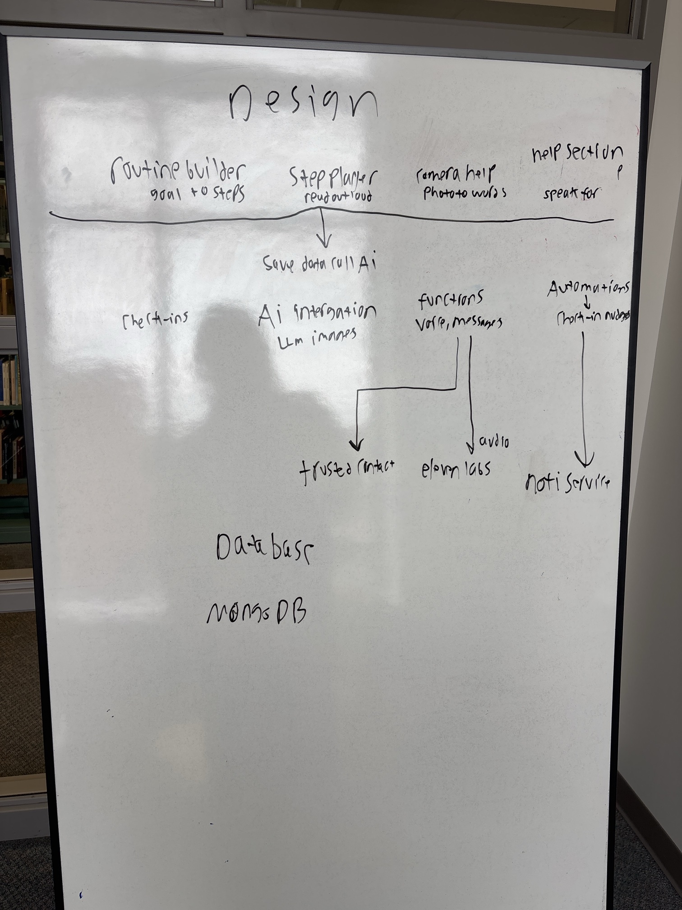
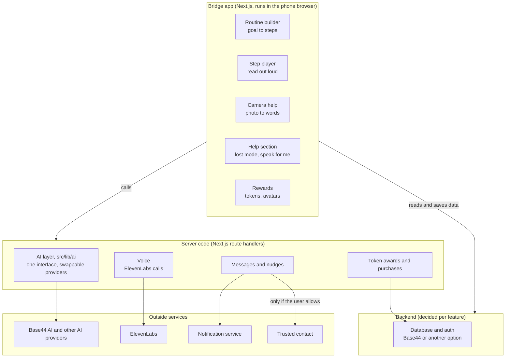

# Architecture

Bridge is a Next.js app built in VS Code. It gets connected to Base44 later, and some features may use Base44 AI. The backend (database, auth) is decided feature by feature.

The whiteboard shows the first plan, where everything lived in Base44. The diagram below is the current plan.

## Layers

### App (frontend, Next.js)
| Screen | Does |
| --- | --- |
| Routine builder | User types or says a goal. Calls the AI layer, then image generation and ElevenLabs per step. Saves Routine and Steps. |
| Step player | Shows one step: picture, short text, audio. Buttons: Done, I'm stuck. Writes CheckIn. |
| Camera help | Upload or take a photo. Sends it to the AI layer. Shows and reads the explanation. Offers reminders for deadlines. |
| Help section | Lost mode (share location), speak for me, trusted contacts, 911 and 988 buttons. |
| Rewards | Token counter, avatar shop, my avatars, streak card. Token awards and purchases go through server code. |

### Server code (Next.js route handlers in `src/app/api/`)
Anything that holds a secret or must not be trusted to the browser runs here.

| Piece | Used for |
| --- | --- |
| AI layer (`src/lib/ai/`) | Every AI call: routines, camera help, stuck help, images. Providers (Base44 AI, OpenAI, others) sit behind one interface, and `models.ts` picks the provider per feature. |
| Voice | ElevenLabs text-to-speech. Audio is generated once and stored on the Step. |
| Messages | Trusted contact messages and location share links, only when the user turned sharing on. |
| Tokens | Awarding tokens when a CheckIn is saved as done, and avatar purchases. |
| Check-in nudges | Finding due steps with no CheckIn and sending a nudge. How it's scheduled depends on the backend choice. |

### Backend (database and auth)
Not locked in. Options per feature: Base44 (entities, auth, file storage, backend functions) or another service. When a feature needs a backend choice that hasn't been made, the team decides before building it. Whatever is chosen, users can only read and write their own records.

### Outside services
| Service | Used for |
| --- | --- |
| Base44 AI and other AI providers | Text, JSON, vision, and image generation, through the AI layer only |
| ElevenLabs | All voice output |
| Notification service | Check-in nudges (in-app, Telegram, or email: Nati to decide) |
| Trusted contact | Gets a message only if the user turned sharing on |

## Connecting to Base44 later

Keep Base44 behind small wrappers so connecting it later doesn't touch feature code:
- AI calls go through `src/lib/ai/providers/base44.ts`.
- Data access goes through helpers in `src/lib/`, not direct calls from components.

## Database note

The whiteboard lists MongoDB. If the team uses Base44 for data, it already includes a database with auth and security rules, so MongoDB isn't needed. Adding MongoDB means hosting it, writing an API, and managing keys. Only add it if the team has a specific reason.

## Demo mode

A `demo_mode` flag on UserProfile makes check-ins fire every 20 seconds from the frontend, so a live demo doesn't wait on real schedules.
