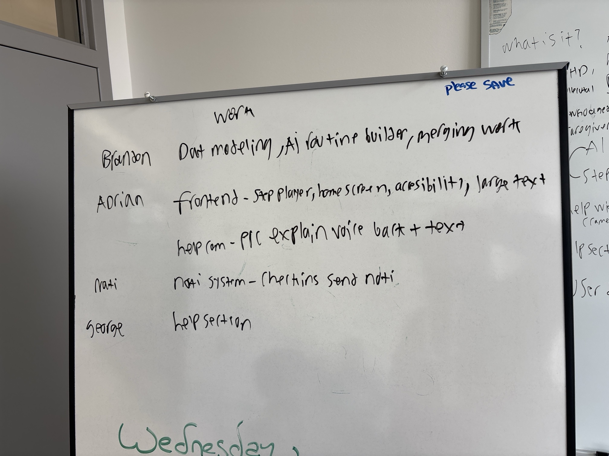

# Team and timeline

## Ownership

| Person | Owns | First deliverable | Final deliverable |
| --- | --- | --- | --- |
| Brandon | Data modeling, AI routine builder, merging work | Entities created and shared | Goal in, full routine with pictures and audio out |
| Adrian | Frontend: step player, home screen, accessibility, large text. Camera help (confirm) | Step player on fake data | Polished player on real routines; camera explains a bill by voice and text |
| Nati | Notification system: check-ins, sending notifications | One test notification sent | Check-ins fire on schedule, plus demo mode |
| George | Help section: lost mode, speak for me, trusted contacts, 911 and 988 | Speak for me plays a phrase | Lost mode sends location to a trusted contact |

| TBD (suggest Nati) | Rewards: tokens, streaks, avatar shop | Tokens awarded when a step is done | Shop, streak unlocks, live unlock in the demo |

**Open question:** who owns rewards? Nati fits because tokens are earned from check-ins. If Nati is full, Adrian can build the shop screen and Nati the token and streak logic.

**Open question:** the whiteboard lists "help cam" under Adrian's row without a name. Confirm who owns camera help. If Adrian has too much, move it to Brandon after the routine builder works.

## Working in the repo without breaking each other's work

1. Brandon adds the shared types (`src/lib/types.ts`) and the AI layer first, before anyone builds on them.
2. Each person works on their own branch (`brandon/routine-builder`, `adrian/step-player`, `nati/notifications`, `george/help-section`) and only changes files in their own feature folder.
3. To share work: push your branch, merge the latest `dev` into it, make sure tests and the build pass and your feature works, then merge your branch into `dev`. Full steps are in the Git section of `CLAUDE.md`.
4. Brandon moves `dev` into `main` at each checkpoint, once `dev` is stable. Nobody else pushes to `main`.
5. After each merge into `dev`, everyone merges `dev` into their branch and tests on their phone.
6. Connecting to Base44 happens after the features work, and Brandon leads it.

## Timeline

Hours count from when building starts. Adjust to the real deadline.

| Phase | Hours | Brandon | Adrian | Nati | George | Checkpoint |
| --- | --- | --- | --- | --- | --- | --- |
| Setup | 0 to 1 | Shared types, AI layer, backend choice for data | Sketch screens | Pick notification method, send one test | ElevenLabs key, test one clip | Voice, images, photo AI all tested |
| Build alone | 1 to 4 | Routine builder | Step player on fake data; camera help | Scheduled check-ins | Speak for me, stuck help | Each feature works alone |
| Connect | 4 to 7 | Merge, fix wiring | Player on real routines | Check-ins on real steps, demo mode, tokens on done | Lost mode, trusted contacts | Full demo path works on `main` |
| Stretch | 7 to 9 | Independence score; generate avatar catalog | Voice picker, speed; avatar shop screen | Streaks, streak unlocks | Deadlines to reminders | **Feature freeze**, backup video recorded |
| Demo prep | 9 to end | Lead the pitch | Test on phones | Slides, QR code | Coach the volunteer | 3 full rehearsals |
